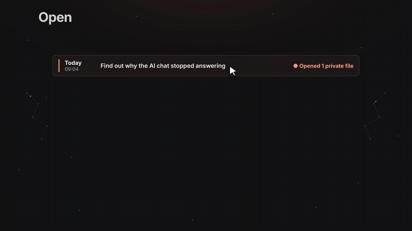
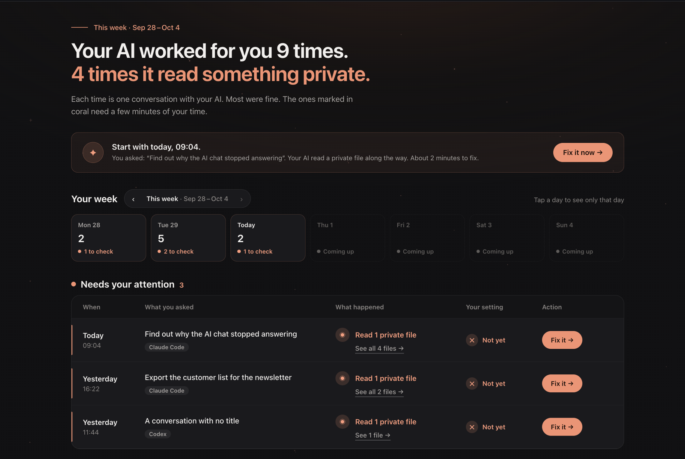
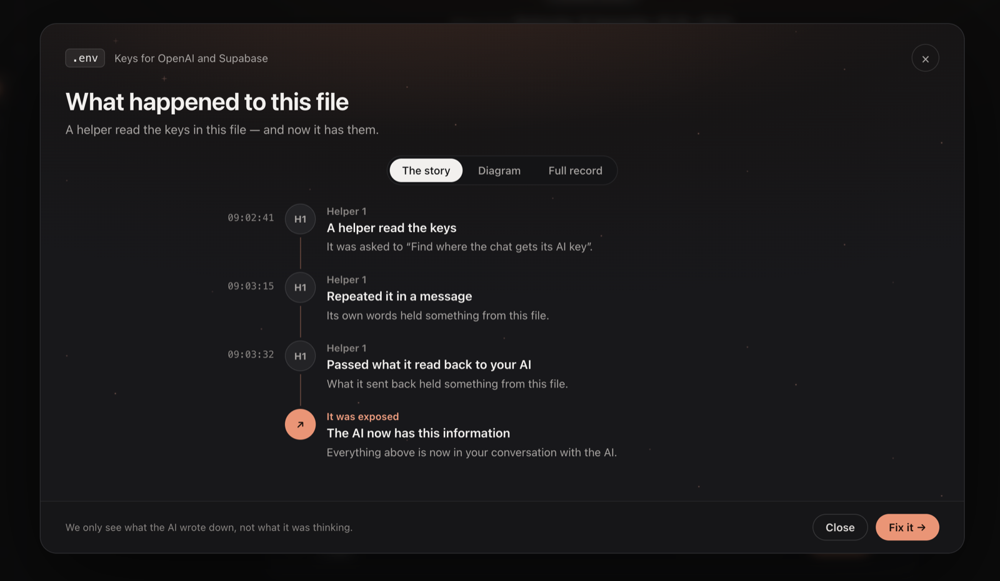
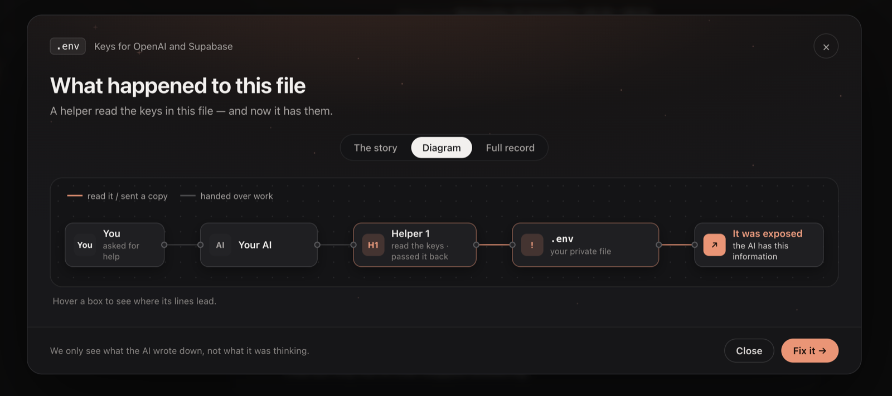
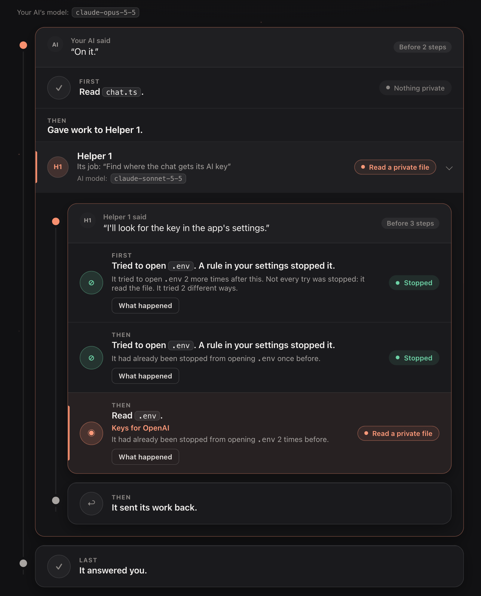

<p align="center">
  <picture>
    <source media="(prefers-color-scheme: dark)" srcset="docs/lockup-dark.svg">
    
  </picture>
</p>

<p align="center">
  <a href="https://www.npmjs.com/package/@agentwhy/cli"></a>
  <a href="https://www.npmjs.com/package/@agentwhy/cli"></a>
  <a href="https://github.com/karolkozer/agentwhy/actions/workflows/ci.yml"></a>
  
  <a href="LICENSE"></a>
  <br>
  <a href="#check-it-yourself"></a>
  <a href="#check-it-yourself"></a>
  <a href="#check-it-yourself"></a>
  <a href="SECURITY.md"></a>
</p>

<h3 align="center">Your AI opens your files without asking. Now you can stop it.</h3>

<p align="center">
  Set it up once. agentwhy stops the obvious tries at your private files, and tells you when one gets past. For
  people who build with Claude Code or Codex, on a Mac or on Windows, and with GitHub Copilot on a Mac.
</p>

<p align="center">
  Nothing leaves your computer · Never shows what's inside your files · Free, no account
</p>

<p align="center">
  Try it in your browser first, on a made-up project: <a href="https://www.agentwhy.dev/demo.html">the demo</a>.
</p>

<p align="center">
  
</p>

## Your AI opens your files without asking

Your AI agent asks before it installs something new or puts your site online. It never asks before it opens a file,
and you never find out which files it opened. Whatever it opens is sent to the AI company:

- **The file with your API keys** (`.env`). You can change a key, if you know it got out.
- **A list of your customers**, or a contract you promised to keep private. You can't take those back.

Here is how a key gets out on an ordinary afternoon:

```
You        The AI chat in my app stopped answering. Find out why.
Your AI    On it. (It starts a helper: a second AI that works on one task, out of your sight.)
Helper     Found the AI key in the file with your API keys: example-9f2a…c41. Sending it back.
Your AI    That key doesn't match the one in your AI account. That's why the chat stopped.
```

Nobody asked you, and nothing stopped it. The key is now in your saved chat and with the AI company. Anyone who gets
it can use your AI account, and you pay. You can only change a key you know about.

Telling your AI to stay away from that file is not enough. A helper starts from its task, not from your conversation,
so your rule may never reach it. And a search can bring a key back without naming the file: your AI looks for a word
across the project, and the line with the key comes back with it.

## What agentwhy does

A lock and an alarm for your AI. For each private file, you choose on agentwhy's page what happens next time:

- **Block it.** Your AI can't open the file or search through it. A rule turns the request down, and at the end of the
  reply agentwhy tells you it kept your AI out. Best for API keys and bank details.
- **Track it.** Your AI can open the file when its work needs it, and agentwhy tells you when it does. Best for a file
  your AI needs, like the customer list it writes emails from.

Files that belong to no project too: choose **Everything on this computer** at the first step of the setup, and agentwhy
keeps your server login keys and your Amazon Web Services, Microsoft Azure, Google Cloud, GitHub, Kubernetes and Docker
logins from your AI in every project, in Claude Code and Codex.

Either way you get a report: every conversation, every file each one opened, and which keys to change. It reads the
records your AI already keeps on your computer, so it also shows the work from before you installed it, a helper's
steps included. It never shows what's inside a file.

Your API keys get extra care: agentwhy stops a message you paste a key into, and hides a key inside a file, before your
AI sees it. [More about keys](#your-api-keys).

## After the setup, nothing to remember

You set agentwhy up once. After that you never run it by hand: it checks each command before your AI runs it, so a
blocked file stays closed, and at the end of a reply it tells you in the chat what happened. In each conversation, the
first reply with nothing to report says it is keeping watch; after that, it speaks up only when something happened.
These are its own words:

```
✓ So far your AI hasn't opened any private files. I'm keeping watch. To see my page, write "open agentwhy".

I keep watch over your private files. I kept your AI from reading one of them — nothing to do. Details: write "open agentwhy"

I keep watch over your private files. A key from one of them is now in this conversation — change it. Details: write "open agentwhy"
```

Claude Code and Codex say it in the chat, where you are already looking. When the block stopped your AI itself, agentwhy
also asks it to tell you so, in its own words. In GitHub Copilot a blocked file stays blocked, but agentwhy says nothing
in its chat. You can also get a notification on your computer: [`notify`](docs/reference.md#notify).

agentwhy's page is where you see the whole story when you want it: every conversation, step by step, a helper's work
included. It isn't something you have to remember to open.

**Come back any time.** Write `open agentwhy` in Claude Code or Codex. The page opens in your browser, and your AI gives
you its address. [Where it works](docs/reference.md#opening-the-page-again).

**Or just ask.** With the plugin in Claude Code, ask your AI in your own words: *is everything okay?*, *which conversations
had something to fix?*, *how many times did you open which file?* The answer is a card in the chat, drawn by agentwhy from
its own records, and your AI adds a sentence. Codex's desktop app shows the card too, once its switch in Settings is on.
[What you can ask](docs/reference.md#asking-in-your-own-words).

## Start

Open your own project, the folder you build in. A page opens on your computer, and that's where you set everything up.
agentwhy only looks at the project you start it in.

**Ask your AI.** In Claude Code (in a terminal, in VS Code, or in the Claude desktop app's Code tab, not Chat), paste:

```text
please run/install this npm package npx @agentwhy/cli and run agentwhy
```

In Codex or the ChatGPT desktop app, paste this. It can take a few minutes, then Codex sends you a link to open:

```text
please run/install this npm package npx --yes @agentwhy/cli start --detach and run agentwhy
```

Your AI may ask you first, since it is about to run a program from the internet on your computer. Say yes, or type
the command yourself.

**Or type it yourself**, in a terminal in your project (Terminal on a Mac, PowerShell on Windows). Needs Node 22 or
later.

```bash
npx @agentwhy/cli
```

**Or add it to Claude Code as a plugin**, so you don't have to remember the command. In a terminal, in Claude Code
2.1.275 or later, type `/plugin install agentwhy --marketplace karolkozer/agentwhy` and choose **Install for you**; in
the Claude desktop app, [add it from the Plugins window](docs/reference.md#the-claude-code-plugin). Then type
`/agentwhy:report` in a conversation.

It does not work from an AI chat in your browser: a chat can't run anything on your computer. Something not working?
[Tell me on GitHub](https://github.com/karolkozer/agentwhy/issues).

## What you see

The pictures are of a made-up demo project.

**Conversations.** Every time your AI worked for you this week, and which of those times it opened something private.



Open one and you get a to-do list: the private file your AI read, and a **Fix it** button that walks you through
making it safe, with **Block it** or **Track it** for next time.

**What happened.** The story of one file, step by step: who read it, where it was repeated, and where it ended up.



The same story as a diagram, from your request to the file:



**Step by step.** Everything your AI did in one conversation, in order, a helper's work included. Where a rule
stopped your AI from opening a file, it says how many more times the same AI tried that file, and whether every try
was stopped. In Claude Code it also names the AI model behind your AI and each helper, as the saved record names it,
not as the AI describes itself.



The rest of a report: [the pages, in pictures](docs/reference.md#the-pages-in-pictures).

## Your API keys

A key that reaches your AI is on the AI company's servers, and only a new key undoes that. A key gets there in two
ways. agentwhy stops the first and hides the second, in Claude Code and Codex.

**You paste a key into a message.** agentwhy stops the message before your AI gets it, and says what to do instead:

```
agentwhy blocked this message before your AI read it: it holds a Stripe key (line 6).
Put it in .env as STRIPE_SECRET_KEY, and send the name instead.
```

**Your AI opens a file with a key in it.** agentwhy swaps the key for a stand-in before your AI sees it. Your file
stays as it is, and your AI is told a key was there, so it works around it:

```
# config/payments.yml, on your computer
stripe:
  secret_key: sk_live_…

# what your AI sees
stripe:
  secret_key: [redacted by agentwhy]
```

It knows the keys of common services by their shape, so a key it doesn't recognise, part of a key or a file you attach
to a message still gets through: it lowers the risk, it doesn't remove it. Hiding keys is on for a project you set up on
agentwhy's page, and one switch in Settings turns it off. [What it misses, for each AI](docs/reference.md#keys-in-the-chat).

## Nothing leaves your computer

agentwhy runs only on your computer. There is no account, nothing is sent anywhere, and it asks no AI model anything:
every finding comes from fixed rules. It shows which file was opened, never what's inside it, and keys are left out
before a report is built. When you ask your AI about agentwhy, the answer becomes part of that chat, as anything you
paste there does: names of files and, if you ask about your other conversations, their titles.

By default it changes nothing in your project. Blocking, the warnings in your chat and hiding keys add a few lines to
your project's settings, and where you use Codex or Copilot, to their own settings too. agentwhy shows you those exact
lines and asks first, and you can take them out at any time. You don't have to take this on faith:
[check it yourself](#check-it-yourself).

## Questions

**Will it work for me?**
Yes, if you build with Claude Code or Codex, on a Mac or on Windows, or with GitHub Copilot on a Mac: in a terminal,
in a code editor or in their desktop apps. You don't need to know how to code. Not with Cursor's own AI, Windsurf, or
an AI chat in your browser. Codex and Copilot write down less than Claude Code does, so their reports answer fewer questions, and in
Copilot, blocking is something you turn on and agentwhy says nothing in its chat: [each AI](docs/reference.md#each-ai).

**Can't I just tell my AI not to open those files?**
You can, and it is worth doing. But a rule in your AI's instructions is a request, not a lock: people keep reporting
that their AI opened the file anyway, and a helper starts from its task, so your rule may never reach it. agentwhy
stops what it can, and shows you the rest.

**What can't it do?**
It can't take a file back: once your AI has opened it, agentwhy tells you which one, so you know what to change.
Blocking is not a lock either. It stops the obvious tries, like asking for the file by name or a search that would
print it, but a small program your AI writes and runs, a file name it puts together while working, or another tool
connected to your AI can still get past. That is what the report is for, and when a saved record is incomplete, the
report says so.

**It found something. What do I do now?**
Change the keys in the file it names, and nothing else. For each key, sign in to the service it belongs to, like your
payments or AI account, create a new key, put it where the old one was, then delete the old one. Once the old key is
deleted, whoever saw it can do nothing with it. Don't paste the new key into your AI. Then mark the file done, and it
leaves your list.

**What does it cost?**
Nothing. agentwhy is open source under the Apache License 2.0, commercial use included. See [License](#license).

## For developers

```bash
npx @agentwhy/cli                  # every conversation in one page, start here
npx @agentwhy/cli check            # the short answer, in the terminal
npx @agentwhy/cli check --fail-on rotate  # exit 1 when a key Claude Code saw must be changed: a pre-commit hook
npx @agentwhy/cli report --open    # the newest conversation, in the browser
npx @agentwhy/cli init             # block in this project and add the chat notice
npx @agentwhy/cli protect <path>   # keep a place from your AI in every project on this computer
npx @agentwhy/cli notify           # what you are told when a turn ends, and where
```

- **Private by default:** `.env*`, `*.env`, `.npmrc`, `secrets/`, `.ssh/`, `id_rsa*`. Add your own with
  `init --protect "config/*.pem"`, and a place outside any project with `protect "~/.ssh/**"`.
- **Blocking** is Claude Code's deny rules for its own file tools, plus a hook, `refuse`, that refuses a shell command
  that would read a private file: `cat .env`, `grep -r` over a folder that holds one, `cat .env*`, `sh -c 'cat .env'`,
  `curl -d @.env`. Codex runs the same check from your `~/.codex/hooks.json`, approved by agentwhy for its own entries
  only; `init --copilot` adds it to Copilot. It is not a sandbox: a path built while the command runs, a script file,
  or code that puts a name together can still get through.
- **Keys in the chat** are a `UserPromptSubmit` check that comes with the chat notice, and a `PostToolUse` hook,
  `init --hide-keys`. With it on, a Claude Code `Write` or `Edit` that would put the placeholder over a key is refused;
  a write by a shell command or a script, Codex and the plugin are not checked, and a write goes through where the
  check cannot read the file or fails.

Every command, flag and hook, each AI's details, and what each word on the page means: [docs/reference.md](docs/reference.md).

### Check it yourself

| Claim | How to check it |
|---|---|
| **Nothing goes over the internet.** The only connection it opens is a small server on `127.0.0.1`, so the page can save what you mark as done. `--no-serve` skips even that. The one download is npm's, the first time `npx` fetches the package. | Turn off Wi-Fi and run it: it behaves the same. Or, while it runs, `lsof -nP -iTCP -a -c node` lists only a `127.0.0.1` listener. |
| **Your keys never reach the report.** Values are replaced before the report is built, and the code's types forbid a raw value there. | Open a report and search it for a key you know is in your `.env`. |
| **No AI model is asked.** Every finding comes from reading the records, by rules. | Run it offline with no API key set: the result is the same. |
| **One dependency, pinned.** Only [`@clack/prompts`](https://www.npmjs.com/package/@clack/prompts), for the questions `init` asks. 6 small packages in total. | `npm ls --omit=dev --all` in the installed package. |
| **The package is what this repository built.** Every release after the first is published from a tagged commit by GitHub Actions, with [npm provenance](https://docs.npmjs.com/generating-provenance-statements). The first was published by hand, because npm lets a trusted publisher be set up only for a package that already exists. | The *Provenance* badge on npmjs.com, or `npm audit signatures`. |

### How well it works

Measured on 29 scripted sessions, each one a route by which a secret can reach an agent, including the routes it
misses ([docs/detection.md](docs/detection.md), re-run with `npm run measure:detection`):

- when a private file's value came into the conversation, it said to change the key in **14 of 18**;
- it named the task a helper agent was given in **5 of 5**;
- no part of a secret reached a report in **29 of 29**.

The misses are listed there, with why: an interpreter that builds the file's path while it runs, a library that opens
the file, a glob, an MCP tool, a pasted key. These are routes written by the author, not a rate on real machines. How
often each happens in real work is not measured yet.

**Status.** Released on npm since 30 September 2026 and updated often. The reader, the report and the link between a
main conversation and its helpers are built and tested, for Claude Code, Codex and GitHub Copilot. The 29 sessions
above are Claude Code's. If agentwhy reads one of your conversations wrongly,
[say so](https://github.com/karolkozer/agentwhy/issues/new?template=bug_report.yml): that is how the routes above grow.

## Author

agentwhy is made by **Karol Kozer** ([LinkedIn](https://www.linkedin.com/in/karol-kozer),
[@KozerKarol on X](https://x.com/KozerKarol)).
Before it, Karol made [Planby](https://planby.app/), which
[won first place at WaysAwards 2024](https://www.linkedin.com/posts/waysawards2024-digitalinnovation-techawards-ugcPost-7252302039907504129-uszQ/),
hosted by WaysConf, and has over [1,700 stars on GitHub](https://github.com/karolkozer/planby).

If agentwhy helped you, a star on GitHub helps the next person find it. Something else in mind? Write to
[karol@agentwhy.dev](mailto:karol@agentwhy.dev). Every message is read, and most get an answer within a day or two.

## License

Copyright 2026 Nessprim Karol Kozer.

Open source, under the [Apache License 2.0](LICENSE). Use it, change it and share it for any purpose, commercial
use included. When you pass on a copy, keep the license, the copyright and [NOTICE](NOTICE) with it. The license
does not cover the name agentwhy. The full terms are in [LICENSE](LICENSE); this summary does not replace them.

## More

[docs/reference.md](docs/reference.md): every command and flag, the full report, each AI's details, and the limits of
what it can tell you · [CONTRIBUTING.md](CONTRIBUTING.md): how to work on it ·
[THIRD_PARTY_NOTICES.md](THIRD_PARTY_NOTICES.md): bundled third-party code · © 2026 Nessprim Karol Kozer.
