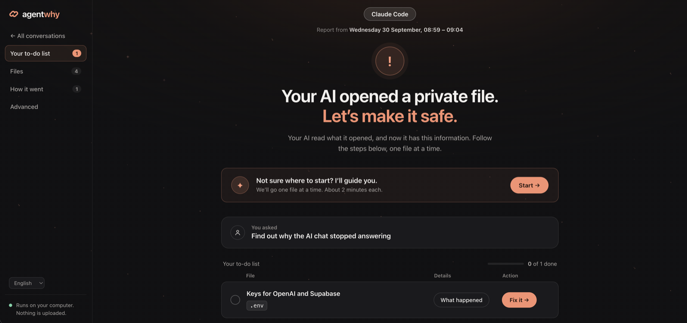
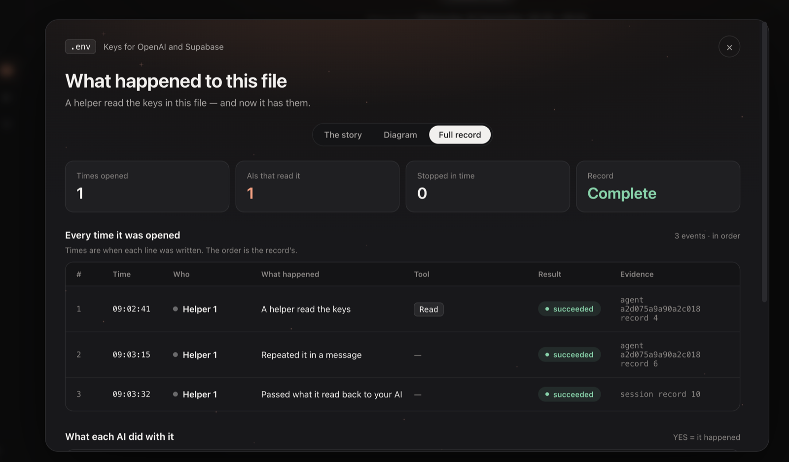
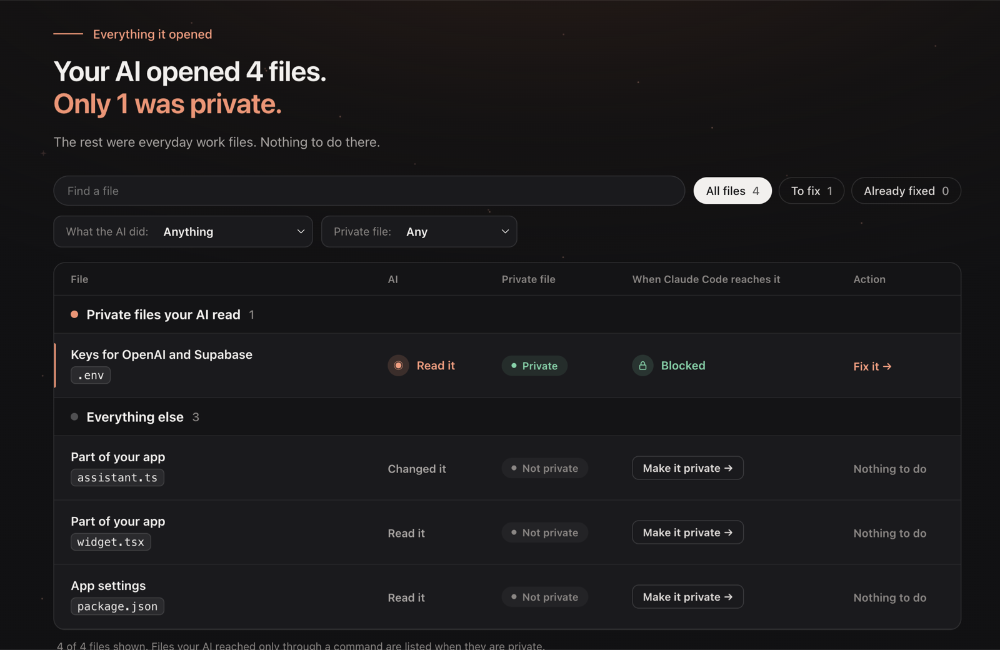
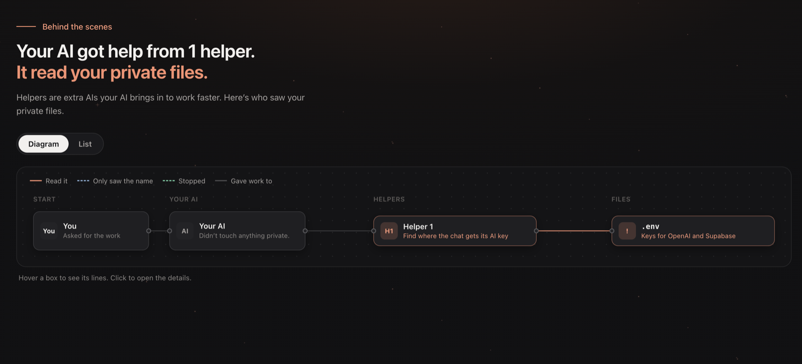

# Reference

Everything the [README](../README.md) leaves out: the commands, the flags, what the report shows, and the
limits of what this tool can tell you.

## Commands

```bash
npx @agentwhy/cli                                # every session on one page, the same as `start`
npx @agentwhy/cli menu                           # a list of the few things to do here; pick one, it runs
npx @agentwhy/cli check                          # what to act on in the last 7 days of sessions
npx @agentwhy/cli start                          # every session on one page, with a report for each
npx @agentwhy/cli report --open                  # the newest session, in the browser
npx @agentwhy/cli report --input <session-dir>   # one session, on stdout; a Codex session file or folder too
npx @agentwhy/cli report --input <id> --open --quiet  # open one session's report, saying only where it is
npx @agentwhy/cli doctor --input <session-dir>   # the record's structure, never its content
npx @agentwhy/cli init                           # set this project up, or undo it
npx @agentwhy/cli init --update                  # move this project's hooks to this version
npx @agentwhy/cli notify                         # what you are told when a turn ends, and when
```

With no command and no terminal — a script, a pipe, CI — `agentwhy` opens and serves nothing: it is a usage
error, `agentwhy: missing command` and exit code 2. A flag with no command in front of it is an unknown command
there; a script that means `start` says `agentwhy start`. `menu` needs a terminal too, and ends with exit code 2
without one.

### `check`

Reads every Claude Code session of the project and prints what to act on, worst first. Codex sessions are on the page
`start` opens, not here:

- **Rotate** — a value from these files was in an agent's context, so it went to the model provider and it is
  kept in the session records. Rotating it is the only step that undoes that.
- **Open routes** — protected paths an agent reached and nothing refused, with the route (`Read`,
  `Bash (cat)`) and the rule that would have closed it.
- **Seen only in results** — files that appeared in what a search printed. No rule on a tool call covers this.
- **Refused** — how often your deny rules held. A refused `Read` raises no hook event, so only the session
  records show these.

### `init`

At a terminal it asks who the setup is for, what agentwhy should do here, and what else to protect. Then it
shows the exact JSON it will add and asks before writing. It writes to `.claude/settings.local.json` — yours,
and out of the repository — unless you say the change is for everyone. The shared `.claude/settings.json` is
only read. On a computer that uses Codex (`~/.codex` exists) it also writes `refuse` and a turn-end message hook into
your own `~/.codex/hooks.json`, and approves those entries — its own and nothing else, never a folder's trust — in
`~/.codex/config.toml`, asking for that apart. Codex skips an unapproved hook without a word, and in VS Code the first
conversation starts before anything can be approved (measured on Codex 0.159), so without this a new project's first
conversation could read the blocked files; with it, Codex blocks from the first message, in the terminal and in VS
Code. Before writing, `init` runs both commands once the way Codex runs a hook, and writes nothing if either fails.
The check reads the rules of the project each command runs in, and does nothing in a project whose rules block no
files. A blocked command is explained in Codex's reply in the terminal or code editor. agentwhy's old entries in a
project's `.codex/hooks.json` are taken out on the next write. `init --remove` keeps the computer-wide check, since
other projects may block files with it; `init --remove --codex` takes it and its approvals out.

| Flag | What it does |
|---|---|
| `--watch` | tells you when an agent wrote a value from a protected file into its own messages. It runs twice: when the agent finishes, to find it, and when your turn ends, to say it — one line in the conversation itself, in any interface. `--notify terminal,os` asks for the pop-up and the system notification instead, which arrive the moment the agent finishes. No channel reaches the model, and none names a path or a value. Ticked by default |
| `--refuse` | runs before every shell command and refuses one whose text names a protected path — `cat .env`. Measured once: Claude Code blocked the command before it ran, and the agent asked the user instead of working around it. It also refuses `cat .env.example` |
| `--protect <pattern>` | a path or pattern to protect, written as `Read(...)` and `Edit(...)` deny rules, so one answer covers both what Claude Code refuses and what agentwhy reads. Repeat for several |
| `--shared` | write to `.claude/settings.json`, which is committed, so the hooks run for everyone who clones |
| `--remove` | undo it. At a terminal it asks what to take out — each hook, and each deny rule by the path it protects — and removes only what is ticked. With `--watch` or `--refuse`, only that hook; deny rules then stay |
| `--unprotect <path>` | with `--remove`, off a terminal: a protected path to take the deny rules of. A rule is never removed unless it is named or ticked |
| `--codex` | alone: write and approve Codex's check, to match the `refuse` Claude Code already runs here. With `--remove`: take agentwhy's entries and their approvals out of `~/.codex` too |
| `--yes` | write without asking, and without asking anything else either |
| `--update` | pin the hooks that run an older release through `npx` to this version, and change nothing else. It takes no other flag but `--yes` |
| `--command <cmd>` | how the hooks run agentwhy. Default: the way the hooks already in the project run it, else the way you ran `init` - `agentwhy` where that is the `agentwhy` on `PATH`, `npx @agentwhy/cli@<this version>` otherwise, pinned so that nothing updates until `--update` (unpinned where the running agentwhy is not a release). Give the same `--command` to `--remove` |

Without rules of your own, the hooks use the built-in default: `.env*`, `*.env`, `.npmrc`, `secrets/`,
`.ssh/`, `id_rsa*`. A hook runs agentwhy the way you ran `init`, or the Settings page: through `npx` it is
`npx @agentwhy/cli`, which resolves the package on every call; installed (`npm install --global @agentwhy/cli`), it
is `agentwhy`, which is faster.

Writing deny rules moves the hooks to your local settings file and copies the shared file's file rules into
it, so nothing stops being protected. `init` says so before it writes.

Both of `watch`'s hooks run the same command line: it reads from the hook input which event it was. Measured, on
Claude Code v2.1.236: a message returned when an agent finishes is discarded, and the same message returned when the
turn ends is shown under the reply — and is not in the model's context either way.

The line looks like this:

```
  └ Stop says: agentwhy · ROTATE: a value from a protected file is in this conversation. 1 file reached.
```

`Stop says:` is how Claude Code labels a line written by a hook that runs when the agent stops; the rest is
agentwhy's. Here it means: a key from a protected file went into this chat, so change that key.

Through `npx`, the hooks are pinned to the version you ran, so agentwhy never updates by itself. When you open a
newer agentwhy, its pages offer to update this project's hooks; `npx @agentwhy/cli init --update` does the same in a
terminal.

### `notify`

What you are told when a turn ends. Run with nothing, it says what is set and which answer is doing the
deciding; with a choice, it writes it and the next turn uses it — no session restarted, and no settings file
touched.

| Flag | What it sets |
|---|---|
| `--on value \| reached \| refused` | which findings are said. `value` is a value from a protected file in the conversation; `reached` adds a protected file opened with no value found; `refused` adds an attempt a rule stopped, which asks for nothing and says a rule held |
| `--clean off \| once \| every-turn` | when a turn that found nothing says so. `once` is the default: the first quiet turn says the session is being watched, which is what silence cannot say. A quiet turn of a session that was not quiet says both, so a clean turn never reads as a clean session |
| `--say agent \| line` | how a value in the conversation is said. `agent`, the default: the turn is kept open and your own agent says it and offers to open the report, with the line beside it. Only in the terminal and the editor extension, never in `claude -p`. `line`: the grey line alone |
| `--notify chat,terminal,os` | where a notice is shown |
| `--everywhere` | your answer for every project, instead of this one |
| `--reset` | take this project's answers out, or with `--everywhere`, yours |

The answers are read in this order: a flag written into a hook's command line, then this project's answer, then
yours, then agentwhy's own. They are kept in `~/.agentwhy/notices.json` — outside every project, so nothing about
how you want to be told is ever written into a repository. The file holds the directories of projects you gave an
answer for, and nothing else: no path inside a project, no value, no session.

## Which project it looks at

agentwhy looks at one project at a time: the folder you run it in. Run it in your project's folder — the one you open
in your code editor. The first page it opens for a project asks which project it is for, and names it on every page
after. Started in your home folder, it only asks which project you mean: it never changes settings there, because
Claude Code reads the settings in your home folder in every project.

It reads the conversations Claude Code keeps on this computer - from the terminal, from your code editor and from the
Claude desktop app - the ones Codex keeps in `~/.codex/sessions`, and GitHub Copilot's, in one list where each row names
its AI. A Claude desktop app conversation takes its title from the app's own record, measured on macOS; where the app
keeps that on Windows is not measured yet. It does not see Cursor's own AI or chats on claude.ai. A Codex home moved
elsewhere with `CODEX_HOME` has not been checked yet.
Codex's own conversation name is used where it has one. For measured `codex exec` records without that name, the first
prompt after its environment context identifies the row and its report; it is redacted before being shown.

It blocks files in Claude Code and Codex, and in GitHub Copilot once you turn it on ([Blocking](#blocking)). In Codex
the block is `refuse`, run as a Codex hook from your own `~/.codex/hooks.json` with
the rules of the project each command runs in, and approved there by agentwhy itself (measured on Codex 0.159), so it
holds from the first message, in the terminal and in VS Code. Its companion Stop hook asks
Codex to explain agentwhy's block in its reply and never to request the file or secret value in chat. It checks only
refusals from the turn that just ended. `check` remains Claude Code's.
Codex's record does not write down every step the AI took, so a Codex conversation can still be marked *Couldn't check
fully* rather than *Nothing to fix*, and its report says what the record leaves out. The row still says when its record
names a private file. A prompt to locate a key says what was asked, not whether the AI read the key's value.
[What a report tells you](#what-a-report-tells-you) lists what a Codex report can and cannot tell you, and the Codex
versions measured.

The project card in the sidebar lists your other projects and shows the one you choose in the same tab. **Choose a
folder…** opens your computer's own folder window — on macOS; the Windows version has not been tried on Windows yet.
To list your projects, agentwhy reads the end of each one's newest conversation on this computer, to learn where its
folder is and when it was last used. The title it finds there goes through the same redaction as every other title,
and the list does not show it. Nothing leaves your computer, and a page made to be shared lists no projects.

## The report

The page answers first — *2 agents saw what is inside sensitive files* — and then draws the session: who was
asked for what, what each agent reached, and which files several agents converged on. Click an agent, a file
or a row and the answer for it appears beside the graph, with what to do, and a step-by-step account behind
one button. Outcome filters count the agents behind each one, every finding keeps a durable `#event-N`
anchor, and one step takes you back where you came from.

It is a single file. It works offline, it makes no network request of any kind, and it still reads top to
bottom with JavaScript disabled. It is written in English, and a selector switches it to Polish or German;
what the record holds — paths, task descriptions, evidence — is quoted exactly as it was written, in any
language.

**A secret value is never in the report.** Values are replaced before the page is written, and the report
says where a value appeared, never what it was.

The same session, on the terminal:

```
 !  2 files this policy protects were reached, 1 of them without any call ever naming it, and 1
    further attempt was refused. An agent's answer carried a value from one of them back to the
    agent that started it. The same value was also written into a file that is not protected.

▍Who ran, and what they reached

  the session itself    4 actions  1 file reached             wrote the value into files
  └─ Agent 1 · Explore  2 actions  1 file reached  1 refused  gave the value back
```

## The pages, in pictures

The [README](../README.md#what-you-see) shows the Conversations page and one file's story. The rest of a report, on
the same demo project:

**Your to-do list.** One conversation, opened: the private file your AI read, and a **Fix it** button that walks you
through making it safe.



**The full record.** One file's story again, as one line for every time the file was opened:



**Files.** Everything your AI opened, with the private files on top and whether each one is blocked or tracked.



**How it went.** The helpers your AI brought in, and which of them saw your private files. Its **Step by step** tab
shows everything your AI did in the conversation, in the order it did it.



## Each AI

Claude Code, Codex and GitHub Copilot keep different records and block in different ways. The README's short answers,
in full.

### Where it works

Claude Code - in the terminal, in code editors and in the Claude desktop app - and Codex, in the terminal, in VS
Code's panel and in the ChatGPT/Codex desktop app. GitHub Copilot's CLI and desktop app, for reports, and for blocking
once you turn it on: **Block in Copilot too** in Settings, or `agentwhy init --copilot`, adds a file of agentwhy's own to
your `~/.copilot/hooks`. Copilot in VS Code is blocked by the same file, and its conversations are in the reports, read
from the log VS Code keeps of each chat (measured on macOS) - the files VS Code itself handed Copilot included. Not
Cursor's own AI, Windsurf or chats on claude.ai. Each conversation on the page is marked with the AI that had it and,
where its record says so, where it was held: in the terminal, in a code editor or in a desktop app.

### Blocking

**Claude Code.** `init` adds rules for Claude Code's own file tools, and a check that refuses a shell command that
would read a private file - `cat .env`, `grep -r` over a folder that holds one, a glob such as `cat .env*`, a `find` or
a loop that opens the files it lists, or a `cd` into the folder before the read. It is not a sandbox. A path built
while the command runs, a script, or a command handed to another shell (`sh -c '…'`) can still get through, and that
is why the main job is telling you what actually happened.

**Codex.** The same check runs as a Codex hook, with the same list of files. When it blocks a command, a second hook
asks Codex to explain the block in its reply in the terminal or code editor, without asking you to paste a secret. The
check is written into your own `~/.codex/hooks.json` and approved by agentwhy itself in `~/.codex/config.toml` - its
own two entries and nothing else, and no folder is marked trusted - because Codex skips an unapproved hook without a
word, and in VS Code the first conversation starts before anything can be approved (measured on Codex 0.159). Before
writing it, `init` runs the check once the way Codex will, and writes nothing if that fails. So it blocks from the
first message, in the terminal and in VS Code, and it acts only in projects whose rules block files. If Codex changes
how it checks approvals, agentwhy's Settings page says the block may ask again instead of claiming it holds.

**GitHub Copilot.** In its CLI, its desktop app and VS Code, the same check runs once you turn it on - **Block in
Copilot too** in Settings, or `agentwhy init --copilot` - from a file of agentwhy's own in `~/.copilot/hooks`, which
names Node and agentwhy by their full paths, since the desktop app runs a hook without your shell's setup. It reads
Copilot's file tools as well as its shell: a read, a write, an edit, a patch or a search that would open a private file
is refused, helpers included, and the refused call carries agentwhy's reason (measured on the CLI 1.0.94 to 1.0.96, the
desktop app, and VS Code's agent mode with three models). In VS Code, a file open in the editor, or attached to a
question, is handed to Copilot by VS Code itself, with no tool call for the check to see - a blocked `.env` open in a
tab reached Copilot that way (measured 2026-10-13): close a blocked file before you ask, and the report shows such a
file as read. Copilot refuses every call whose hook fails to start, so where agentwhy cannot start the call runs
unchecked instead; where the Node or the agentwhy the file names is gone, Settings says the check needs setting up
again.

In every AI the check reads a command for what it would read: a shell command that only writes into a blocked file,
such as `echo X=1 >> .env`, still runs.

### What a report tells you

Codex writes down less than Claude Code does, and Copilot's blocking is one you turn on, so each answers different
questions:

| What the report tells you | Claude Code | Codex | Copilot |
|---|---|---|---|
| Which private files the AI opened, and with which command | yes | yes, where its record shows the file was opened - a command that finished is not enough | yes, with its own file tools and in the shell; a shell command that failed is not counted as a read |
| What a command or a search printed | yes | yes | yes; past a very large output's preview, it says it doesn't know the rest |
| Whether the AI was handed what was printed | yes | yes, where its record holds the whole output the AI was given back; where Codex cut it short, it says it doesn't know the rest | yes |
| Every step the AI took | yes | no: some steps leave no trace. Where the only gaps are the ones every Codex record has, the report answers as it does for Claude Code - **All good.** included; where a step could have reached a private file and the record doesn't show what it did, it says it could not check fully | yes. What it was thinking is kept in a form agentwhy can’t read; a conversation with nothing else missing still says **All good.** |
| A read a rule stopped | yes | yes, when agentwhy's own refusal is recorded in a code cell | yes, and who stopped it: a rule, you, or a check another tool runs - never said to be your rule |
| Which helper was asked to do what, and what it gave back | yes | yes | yes, a helper working in the background too |
| Which files the AI changed | yes | yes; a change that failed is not counted | yes |
| What Codex was allowed to do at the time | - | yes, shown apart from your own rules | - |
| Blocking a file | yes | yes, the same files, from the first message - agentwhy approves its own check in your `~/.codex` files (measured on 0.159) | yes, once you turn it on: its shell and its read, write, edit and search tools, helpers included, in the CLI, the desktop app and VS Code (measured on 1.0.94 to 1.0.96, and in VS Code's agent mode). Not the tools it connects to (MCP), a blocked file's name in a list of files, or a file VS Code hands Copilot itself - one open in the editor or attached to a question. If agentwhy can't start - after a Node upgrade, say - Copilot runs the call unchecked rather than stopping your work; where the paths it names are gone, Settings says so |
| A message in the chat after agentwhy blocks a command | yes | yes, in the terminal, in VS Code and in the ChatGPT/Codex app | no message of its own: the refused call carries agentwhy's reason, which the CLI shows on the call's line; whether the reply names agentwhy is up to the model |
| A warning when a value reached the chat | yes | yes, at the end of a reply: a key from a private file, a file you let it read, and once per chat that nothing private was opened | no |
| `check`, the short answer in the terminal | yes | no: Codex conversations are on the page `start` opens, not in `check` | no: like Codex's, on the page `start` opens |

Where a Codex record keeps no command of its own - every conversation held in VS Code's panel, and older files -
agentwhy reads the commands the code wrote out as text. One the code builds while it runs is not read, and the report
says the record has gaps. What Codex writes down was measured on macOS: `codex exec` 0.157.0, and 0.159 and 0.160 in the
terminal, in VS Code's panel and in the desktop apps. Other versions and computers are read too, and their reports say
what could not be checked.

What Copilot writes down was measured on macOS: the CLI 1.0.94 and 1.0.95 and the desktop app's 1.0.94-3, which keep
one record for both. Every 1.0 version is read the same way until its record holds something new; a later version is
read, and its report says what could not be checked.

## What it does not do

- **It does not protect files.** That is what `permissions.deny`, file permissions and sandboxing are for.
  The one thing it can refuse is a shell command whose text names a path your rules already protect — and a
  deny rule names a tool, not a file, while `refuse` matches the text of a command. A path held in a variable,
  or printed by a search, still gets through.
- **`refuse` reads the command line, not what runs.** It stops a command that names a protected file, a glob that
  expands to one (`cat .env*`), a `grep -r` or `rg` that would read one, and a listing whose names another program
  opens (`find -exec cat`, `find | xargs cat`, `for f in $(find …)`). A path held in a variable, reached after `cd`,
  or built while the command runs can pass it, and so can a search it does not recognise (a script, a program it
  does not know). What actually holds is a sandbox, or keeping secrets out of files with a
  secret manager: if there is nothing on disk to read, there is nothing to expose from disk.
- **It is not an audit trail**, and it is not a security assessment of your project.
- **It does not judge intent.** It reports what the record holds, and says when the record is incomplete.

## Words used here

| Word | Meaning |
|---|---|
| **Session** / **conversation** | One chat with Claude Code or Codex, from the first message to the last. Each saves it as files on your computer. |
| **Subagent** / **helper** | A second AI the main agent starts and hands a task to. It gets only that task, not your earlier conversation, and its work is saved in a file of its own. |
| **Protected file** | A file you told agentwhy matters: by default `.env*`, `.npmrc`, `secrets/`, SSH keys. |
| **Reached** | The file's contents came into the conversation — the agent opened it, or a command printed it. |
| **Refused** | A rule stopped the read before it happened. Nothing came into the conversation. |
| **Seen in a result** | Nobody named the file, but a search printed its lines anyway, e.g. `grep -rn API_KEY .` |
| **Deny rule** | A line in Claude Code's settings that forbids its own file tools to read a path. |
| **Hook** | A command Claude Code runs at a fixed moment, e.g. before a shell command or when a turn ends. agentwhy uses hooks to refuse obvious reads and to tell you what happened. |
| **Rotate** | Replace a key with a new one at the service that issued it, so the copy that leaked stops working. The only thing that undoes a leak. |
